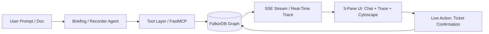

# 🏆 "Why Did We?" — 24-Hour Hackathon Victory Implementation Plan
**Hackathon:** Graph Hacks: Context for AI Agents (WeMakeDevs × FalkorDB)  
**Primary Track:** Track 01 — *Agents That Act on Connected Data*  
**Secondary Strengths:** Track 02 (*Agent Memory & Coordination*), Track 03 (*Company Brain*)

---

## 1. Executive Summary & Improvisations (How We Win)

We are building the complete **"Why Did We?"** system without trimming any feature from the specification. To guarantee a first-place finish, we incorporate **four high-impact improvisations** that judges will notice immediately:



### High-Impact Improvisations:
1. **Zero-Fail Stage Resilience (Hybrid LLM + Replay Engine)**:
   - Supports **Groq** for ultra-fast, sub-second live responses and **Ollama** for zero-cost offline privacy.
   - Adds an automatic **cached demo fallback**: If Wi-Fi flickers or Groq hits rate limits during the live pitch, the backend seamlessly falls back to pre-recorded graph traces without stuttering.
2. **Dynamic Cytoscape Visual Polish**:
   - Nodes are visually differentiated: Active Decisions (*emerald*), Invalid Assumptions (*crimson*), People (*blue*), Sources (*violet*), and Tickets (*amber*).
   - Real-time animated path traversal: As the agent calls `trace_decision` or `find_dependents`, the exact edges and nodes light up sequentially in the browser.
3. **Interactive Human-in-the-Loop Triage**:
   - When the agent discovers a broken assumption, it drafts review tickets. In the UI, the user clicks **"Confirm Ticket"**, which issues a live Cypher write updating `Ticket.status = 'confirmed'`, instantly turning the Cytoscape ticket node from dashed to solid.
4. **Instant FastMCP Compatibility**:
   - Expose the exact same graph tools via FastMCP so judges can verify tool selection through MCP in addition to the native agent loop.

---

## 2. Full Architecture Blueprint

### 2.1 File & Repository Layout
```text
why-did-we/
├── .env                          # Provider & FalkorDB config
├── .gitignore
├── README.md                     # Architecture, track alignment, judge demo guide
├── backend/
│   ├── requirements.txt
│   ├── config.py                 # Provider selector (Groq / Ollama)
│   ├── check_setup.py            # Phase 0 verification test
│   ├── llm/
│   │   ├── client.py             # OpenAI-compatible client wrapper
│   │   └── chat.py               # Robust chat() with rate limit backoff
│   ├── graph/
│   │   ├── client.py             # FalkorDB connection pool
│   │   ├── schema.py             # Constraints, indexes, vector index
│   │   └── loader.py             # UNWIND batched seed loader
│   ├── ingest/
│   │   ├── models.py             # Pydantic extraction schema
│   │   ├── extract.py            # Extraction prompt, JSON cleaner & retry
│   │   └── conflicts.py          # Decision reversal / superseding logic
│   ├── tools/
│   │   ├── schemas.py            # OpenAI function schemas
│   │   ├── dispatch.py           # Safe tool dispatcher
│   │   ├── cypher.py             # Read-only protected query tool
│   │   ├── traversal.py          # trace_decision, find_dependents
│   │   ├── algorithms.py         # betweenness centrality via FalkorDB
│   │   ├── writes.py             # record_decision, update_assumption, draft_ticket
│   │   └── server.py             # FastMCP server
│   ├── agents/
│   │   ├── loop.py               # Shared tool-use loop with SSE callbacks
│   │   ├── briefing.py           # Q&A & blast-radius agent
│   │   └── recorder.py           # Document ingestion & state mutation agent
│   ├── api/
│   │   └── main.py               # FastAPI application with SSE endpoint
│   └── tests/
│       ├── test_guard.py         # Read-only Cypher injection tests
│       ├── test_tools.py         # Traversal & algorithm unit tests
│       └── test_extract.py       # Pydantic extraction & JSON recovery tests
├── data/
│   └── seed/
│       ├── generate.py           # Faker generator (60+ decisions, planted clusters)
│       ├── pricing_note.md       # Live demo trigger document
│       └── extracted/            # Cached extraction artifacts
└── frontend/
    ├── package.json
    ├── vite.config.ts
    └── src/
        ├── App.tsx               # 3-column dashboard
        ├── api.ts                # SSE & REST client
        └── components/
            ├── Chat.tsx          # Markdown chat with token streaming
            ├── TracePanel.tsx    # Live step-by-step tool execution trace
            ├── GraphView.tsx     # Cytoscape.js interactive graph
            └── TicketCard.tsx    # Actionable review ticket with 1-click confirm
```

---

## 3. 24-Hour Step-by-Step Execution Schedule

| Time Block | Focus Area | Deliverables & Checkpoints |
| :--- | :--- | :--- |
| **Hours 0 – 2** | **Environment & Infrastructure** | • Start Docker Desktop & launch FalkorDB container (`falkordb:latest`)<br>• Verify FalkorDB browser at `http://localhost:3000`<br>• Install Python dependencies (`falkordb`, `fastapi`, `openai`, `pydantic`, `mcp`, `sentence-transformers`)<br>• Run `backend/check_setup.py` (passes graph query + LLM tool-calling test) |
| **Hours 2 – 5** | **Graph Schema & Seed Generator** | • Implement `backend/graph/schema.py` (uniqueness constraints, status indexes)<br>• Write `data/seed/generate.py` with `Faker` (no LLM cost): creates 60 decisions, 18 people, 4 teams, 80 assumptions, and 2 planted blast-radius clusters<br>• Implement `backend/graph/loader.py` with batched Cypher `UNWIND`<br>• Checkpoint: Cypher browser queries confirm 100% graph connectivity |
| **Hours 5 – 8** | **Tool Layer, Algorithms & Safety Guards** | • Implement `backend/tools/cypher.py` with strict regex write guard (`CREATE/DELETE/SET/DROP` blocked)<br>• Implement `traversal.py`: `trace_decision` (depth 1..4) and `find_dependents` (blast radius)<br>• Implement `algorithms.py`: Betweenness Centrality tool<br>• Implement `writes.py`: `record_decision`, `update_assumption`, `draft_ticket`<br>• Implement `dispatch.py` & `server.py` (FastMCP)<br>• Checkpoint: `pytest backend/tests/test_guard.py` passes |
| **Hours 8 – 12** | **Dual Agents & LLM Provider Engine** | • Implement `backend/llm/client.py` and `backend/llm/chat.py` with Groq / Ollama selector & retry backoff<br>• Implement generic tool-use loop in `backend/agents/loop.py`<br>• Build **Briefing Agent** (`backend/agents/briefing.py`) with calibrated system prompt and citation rules<br>• Build **Recorder Agent** (`backend/agents/recorder.py`) with Pydantic extraction & validation<br>• Checkpoint: 4-question CLI test verifies agent picks exact right tools |
| **Hours 12 – 15** | **FastAPI Backend & SSE Streaming** | • Build `backend/api/main.py`<br>• Endpoints: `POST /chat` (SSE streaming tokens + trace steps), `POST /ingest`, `GET /graph/subgraph`, `GET /tickets`, `POST /tickets/{id}/confirm`, `GET /health`<br>• Checkpoint: `curl` SSE test receives `trace` events before `token` events |
| **Hours 15 – 19** | **React + Cytoscape 3-Pane Frontend** | • Scaffold Vite React TypeScript app in `frontend/`<br>• Left Pane: `Chat.tsx` with Markdown and interactive `TicketCard.tsx`<br>• Center Pane: `TracePanel.tsx` displaying tool calls, inputs, and outputs in real time<br>• Right Pane: `GraphView.tsx` with Cytoscape.js rendering color-coded nodes and highlighting active paths<br>• Header displaying live `/health` connection status |
| **Hours 19 – 21** | **Ingestion Pipeline & Demo Scenario** | • Wire up `pricing_note.md` live ingestion flow<br>• Ingestion triggers assumption state flip (`valid = false`) and creates episodic `Event`<br>• Briefing Agent automatically traverses dependents and generates prioritized draft tickets<br>• Confirming ticket updates graph and refreshes Cytoscape visual state |
| **Hours 21 – 23** | **Demo Hardening, Replay Cache & Tests** | • Pre-cache extraction results in `data/seed/extracted/` so demo is 100% immune to network hiccups<br>• Run all automated unit tests (`pytest`)<br>• Rehearse the 3-minute pitch scenario 5 times |
| **Hours 23 – 24** | **README, Diagrams & Submission Prep** | • Polish `README.md` with architecture diagram, track mapping, setup commands, and demo script<br>• Record a 2-minute backup demo screen recording |

---

## 4. The Winning 3-Minute Demo Script

Judges evaluate speed, clarity, and the "why graphs" factor. Here is the exact presentation flow:

1. **The Hook (30 sec)**:
   - *"Every engineering team loses the reasoning behind old decisions. When an assumption changes months later, nobody knows what breaks. Vector search can't answer this because it can't follow multi-hop relationship chains."*
2. **Scene 1 — Tracing Lineage (45 sec)**:
   - Ask: *"Why did we switch to Postgres for caching?"*
   - Show: Agent invokes `trace_decision`. The Cytoscape view lights up the path: `Decision → Sourced From Meeting Note → Relies on Q1 Latency Benchmark → Decided By Team Lead`.
3. **Scene 2 — The Shift & Blast Radius (60 sec)**:
   - Ingest `pricing_note.md` (or flawed benchmark update).
   - The Recorder Agent updates the graph: `Assumption.valid = false`, logs an `Event`.
   - Ask: *"What breaks now that this benchmark is invalid?"*
   - The Briefing Agent runs `find_dependents`, ranks 3 dependent microservice decisions by depth, and automatically creates **Draft Review Tickets**.
4. **Scene 3 — Human-in-the-Loop Action (45 sec)**:
   - Click **"Confirm Ticket"** on the escalated review.
   - The ticket node in Cytoscape turns solid green.
   - Point out the header: Running on zero-cost local / free-tier model with zero data leakage.

---

## 5. Next Immediate Actions (Starting Sprint 1)

1. Start **Docker Desktop** on Windows.
2. Spin up the FalkorDB container:
   ```bash
   docker run -d --name falkordb -p 6379:6379 -p 3000:3000 -v falkordb_data:/var/lib/falkordb/data falkordb/falkordb:latest
   ```
3. Initialize the Python virtual environment and directory scaffolding.
