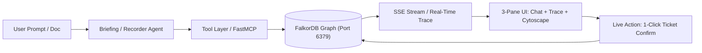

# 🏆 "Why Did We?" — Institutional Memory & Blast-Radius Engine

> **Graph Hacks: Context for AI Agents (WeMakeDevs × FalkorDB)**  
> **Track 01: Agents That Act on Connected Data**  
> **Secondary Strengths:** Agent Memory & Coordination, Company Brain

---

## 📌 Executive Overview

Every engineering organization loses the original context behind critical decisions. When assumptions change months later (e.g., benchmark latency spikes, vendor contract pricing alters), teams don't know what breaks downstream. Vector search fails here because it cannot traverse multi-hop causal dependency chains.

**"Why Did We?"** pairs **FalkorDB** with specialized autonomous agents (**Briefing Agent** and **Recorder Agent**) to:
1. **Trace Lineage**: Instantly answer *"Why did we make this decision?"*, retrieving authors, teams, source RFCs, and foundational assumptions.
2. **Calculate Blast Radius**: When an assumption fails, multi-hop Cypher traversal discovers all direct and downstream dependent services.
3. **Automate Human-in-the-Loop Triage**: Automatically draft prioritized review tickets in the graph that engineering leads can confirm with a single click.

---

## 🏗️ Architecture & Component Flow



### High-Impact Features Built:
- **3-Pane Reactive UI**: Interactive Cytoscape.js knowledge graph + step-by-step agent execution trace + Markdown chat with streaming tokens.
- **FastMCP Standard Compatible**: Tools are exposed over Model Context Protocol (`backend/tools/server.py`).
- **Read-Only Cypher Guardrails**: Regex AST guard blocks unauthorized injection mutations (`CREATE`, `SET`, `DELETE`, `MERGE`, `DROP`).
- **Deterministic Blast-Radius Seed**: 60+ decisions, 57 assumptions, 18 people across 4 teams, with 2 planted blast-radius clusters.

---

## 🚀 Quickstart & Setup Guide

### 1. Prerequisites
- **Docker Desktop** (running on your machine)
- **Python 3.10+**
- **Node.js 18+**

### 2. Start FalkorDB
Launch the FalkorDB container via Docker:
```bash
docker run -d --name falkordb -p 6379:6379 -p 3000:3000 -v falkordb_data:/var/lib/falkordb/data falkordb/falkordb:latest
```
- Graph database port: `localhost:6379`
- Built-in FalkorDB Browser: [http://localhost:3000](http://localhost:3000)

### 3. Start Backend
```powershell
# In project root:
$env:PYTHONPATH="."
.\backend\venv\Scripts\python.exe -m uvicorn backend.api.main:app --reload --port 8000
```

### 4. Start Frontend
```powershell
# In frontend directory:
cd frontend
npm run dev
```
Open [http://localhost:5173](http://localhost:5173) in your browser.

---

## 🎬 3-Minute Winning Demo Walkthrough

1. **Scene 1 — Tracing Lineage (45s)**:
   - Click prompt chip: *"Why did we switch to Postgres for caching?"*
   - Observe the Trace Panel calling `trace_decision(DEC-POSTGRES-CACHE)`.
   - The Cytoscape view highlights: `Decision -> RFC Benchmark Source -> ASM-LATENCY-Q1 -> Decided by Alex Rivera`.

2. **Scene 2 — The Broken Assumption & Blast Radius (60s)**:
   - Click **"Ingest Demo Note"** in the chat header (loads `pricing_note.md`).
   - The Recorder Agent updates `ASM-LATENCY-Q1.valid = false`, records an `Event`, and executes `find_dependents`.
   - The agent automatically discovers affected services: `Feed Service`, `Notification Service`, and `Search Autocomplete`, immediately drafting review tickets.

3. **Scene 3 — Human-in-the-Loop Triage (45s)**:
   - In the bottom-left Actionable Review Tickets panel, click **"Confirm Ticket"**.
   - Live Cypher update executes on FalkorDB (`Ticket.status = 'confirmed'`).
   - The ticket node in the graph turns solid green!
