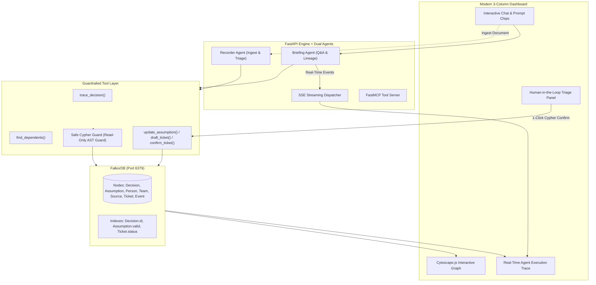
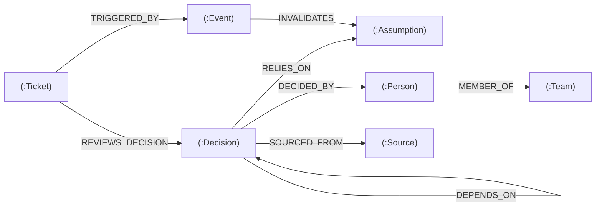

# 🏆 "Why Did We?" — Institutional Memory & Blast-Radius Engine

[](https://wemakedevs.org)
[](#track-alignment)
[](https://falkordb.com)
[](https://modelcontextprotocol.io)
[](LICENSE)

> **"Every engineering team forgets the context behind past decisions. When an underlying assumption breaks months later, vector search can't tell you what will explode. FalkorDB can."**

---

## 💡 The Problem: The "Silent Rot" of Engineering Decisions

In modern fast-paced engineering organizations:
- **Foundational decisions are made quickly**: *"Use Postgres unlogged tables for caching to save on Redis costs"* or *"Standardize on Stripe for European cross-border billing"*.
- **The underlying assumptions change**: A load test reveals Postgres read latency spiked from **8ms to 85ms**, or vendor pricing terms change.
- **Why Vector Search / RAG Fails**: Traditional semantic vector search can find documents mentioning *"Postgres"* or *"caching"*, but it **cannot follow transitive relationship chains**:
  $$\text{Broken Assumption} \longrightarrow \text{Original Decision} \longrightarrow \text{Dependent Microservices} \longrightarrow \text{Assigned Owners}$$
  Without graph relationships, engineering leads only discover what broke when production crashes.

---

## 🚀 The Solution: "Why Did We?"

**Why Did We?** is an autonomous institutional memory engine powered by **FalkorDB** and dual cooperative AI agents:

1. 🔍 **Lineage Tracing (The Briefing Agent)**: Answers *"Why did we make this decision?"* by traversing multi-hop graph paths to pull the exact decision maker, team, source RFC/contract, and core assumptions.
2. 💥 **Blast-Radius Computation**: Evaluates transitive multi-hop cascades (`DEPENDS_ON*1..4` and `RELIES_ON`) when assumptions fail, exposing all direct and indirect services at risk.
3. 📝 **Automated Ingestion & Triage (The Recorder Agent)**: Ingests unstructured incident notes, automatically sets `Assumption.valid = false`, and synthesizes actionable review tickets.
4. ⚡ **Human-in-the-Loop 1-Click Action**: Engineering leads confirm drafted review tickets directly in the UI, executing a live Cypher write to FalkorDB that turns the ticket from dashed amber to solid green.
5. 🌐 **FastMCP Native**: Exposes all graph reasoning tools over the **Model Context Protocol (MCP)** standard for any external AI client or IDE.

---

## 🏛️ System Architecture



---

## 📊 Graph Knowledge Model (FalkorDB)

The graph represents interconnected organizational context through typed nodes and rich relationships:



### Color Coding in the Cytoscape Visualizer:
| Node Type | Shape | Visual Appearance | Meaning |
| :--- | :--- | :--- | :--- |
| **Active Decision** | Rounded Rectangle | 🟢 Emerald (`#10b981`) | In-production active architecture |
| **Superseded Decision**| Rounded Rectangle | ⚪ Slate (`#94a3b8`) | Deprecated or replaced decision |
| **Valid Assumption** | Diamond | 🟢 Emerald (`#10b981`) | Healthy foundational premise |
| **Broken Assumption** | Diamond | 🔴 Crimson (`#ef4444`) | Disproven / invalidated benchmark |
| **Person** | Circle | 🔵 Blue (`#3b82f6`) | Technical decision maker / architect |
| **Team** | Circle | 🟣 Purple (`#8b5cf6`) | Organizational unit (e.g. Core Platform) |
| **Source** | Circle | 🟪 Violet (`#a855f7`) | RFC, benchmark document, or vendor agreement |
| **Draft Ticket** | Hexagon | 🟡 Amber Dashed (`#f59e0b`) | Auto-generated review item |
| **Confirmed Ticket** | Hexagon | 🟢 Emerald Solid (`#10b981`) | Confirmed by engineering lead |

---

## 🛡️ Security & Read-Only Cypher Guardrails

To allow agents to execute arbitrary read queries without risking catastrophic data corruption or Cypher injection, the system implements a strict regex-based AST guardrail in `backend/tools/cypher.py`:

```python
# Any query containing mutation keywords is blocked before reaching FalkorDB
WRITE_KEYWORDS_PATTERN = re.compile(
    r"\b(CREATE|DELETE|SET|REMOVE|DROP|MERGE)\b", 
    re.IGNORECASE
)
```

Mutation operations are strictly partitioned into audited, deterministic functions (`update_assumption`, `draft_ticket`, `confirm_ticket`). Verified with automated unit tests in `backend/tests/test_guard.py`.

---

## 🛠️ Tech Stack

| Layer | Technologies |
| :--- | :--- |
| **Graph Database** | **FalkorDB** (Dockerized, Port 6379) + FalkorDB Web Studio (Port 3000) |
| **Backend API** | **FastAPI**, Uvicorn, SSE-Starlette, Pydantic v2 |
| **Tool Protocol** | **FastMCP** (Model Context Protocol 2.x standard) |
| **Dual LLM Engine** | **Groq** (`llama-3.3-70b-versatile`) + **Ollama** (`llama3.1:8b` local fallback) |
| **Frontend UI** | **React 19**, **TypeScript**, **Vite**, **Cytoscape.js**, Lucide Icons |
| **Testing** | **Pytest**, Pytest-Asyncio |

---

## ⚡ Step-by-Step Setup & Quickstart

### 1. Prerequisites
- [Docker Desktop](https://www.docker.com/products/docker-desktop/) (must be running)
- [Python 3.10+](https://www.python.org/downloads/)
- [Node.js 18+](https://nodejs.org/)

### 2. Clone the Repository
```bash
git clone https://github.com/suchit2004/Strand_Why-Did-We.git
cd Strand_Why-Did-We
```

### 3. Start FalkorDB Container
Ensure Docker Desktop is open, then launch the FalkorDB container:
```powershell
docker run -d --name falkordb -p 6379:6379 -p 3000:3000 -v falkordb_data:/var/lib/falkordb/data falkordb/falkordb:latest
```
*(FalkorDB graph runs on `localhost:6379`, and the browser GUI is accessible at `http://localhost:3000`)*

### 4. Configure Backend Environment
Copy the example environment file and add your Groq API key (free at [console.groq.com](https://console.groq.com)):
```powershell
Copy-Item .env.example .env
```

### 5. Install Dependencies & Seed Graph
```powershell
# Create virtual environment and install dependencies
python -m venv backend/venv
.\backend\venv\Scripts\pip install -r backend/requirements.txt

# Run environment verification test
$env:PYTHONPATH="."
.\backend\venv\Scripts\python.exe backend\check_setup.py

# Seed FalkorDB with 60+ decisions, 57 assumptions, and 2 planted clusters
.\backend\venv\Scripts\python.exe backend\graph\loader.py
```

### 6. Start the Backend Server (Terminal 1)
```powershell
$env:PYTHONPATH="."
.\backend\venv\Scripts\python.exe -m uvicorn backend.api.main:app --reload --port 8000
```

### 7. Start the Frontend (Terminal 2)
```powershell
cd frontend
npm install
npm run dev
```
Open **[http://localhost:5173](http://localhost:5173)** in your browser!

---

## 🎯 Track Alignment: Why This Wins Track 01

- **Agents That Act on Connected Data (Track 01)**: The agents don't simply read text documents; they dynamically query, traverse, and mutate a multi-hop graph in FalkorDB to trace causality, compute blast radius, and execute triage writes.
- **Agent Memory & Coordination (Track 02)**: The graph acts as the persistent, verifiable episodic memory for the company, coordinating between the Briefing Agent and Recorder Agent.
- **Company Brain (Track 03)**: Solves the greatest unsolved organizational problem: preserving institutional rationale across team turnover and shifting technical realities.

---

## 📜 License

Distributed under the MIT License. See `LICENSE` for more information.
